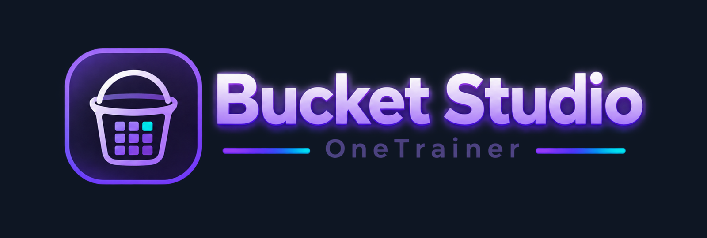
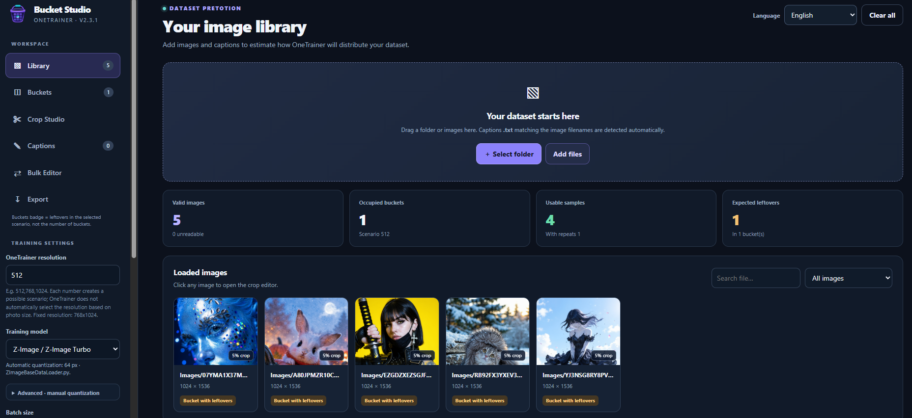

# ComfyUI Bucket Studio
**A local dataset preparation tool for OneTrainer.**

Bucket Studio is a local, offline-first dataset preparation tool for OneTrainer, featuring image cropping, bucket analysis and optimization, multi-resolution simulation, AI-powered captioning with Ollama, and bulk caption editing; all using a simple integration with Ollama and displaying it with HTML.

I built this tool to assist with cropping and data preparation for my training sessions using OneTrainer; the integration with Ollama was an additional feature for broader utility, though I still prefer to use Florence2 and analyze the images one by one, using the various other tools within this Studio.

I had more than 100 LoRAs created using this tool (that’s why it’s already in a later version). So far, Its been helping me a lot; hope that helps you too!

## Latest release
### 2.3.1
Update
- Fixed **Find & Replace** incorrectly re-capitalizing replacements: `A` → `a` now works exactly as typed, including with *Ignore case* disabled.
- Clarified that *Ignore case* affects **matching only**, never the case of the replacement value (EN/PT-BR).
- Improved whole-word literal search to recognize Unicode letters and digits, including accented captions; underscored training triggers are not matched internally.
- Regressions checked across Find & Replace, Add Prefix, Add Suffix, Remove Text, Clean Captions, Advanced Regex, per-image selection, Undo/Redo, caption inspector, and paired `.txt` export.
- Preserved all v2.3.0 bucket simulation, crop, Ollama and export features.

## Quick start
1. Install and start [Ollama](https://ollama.com/) if you want automatic captions. Pull at least one **vision-capable** model (a text-only model cannot caption photos).
2. Have **Python 3** available (standard library only; no pip packages required) and double-click `start-local.bat`.
3. The app opens in your browser at `http://127.0.0.1:8765/index.html`.
4. Import your image folder in **Library**, analyze in **Buckets**, optionally adjust in **Crop Studio**.
5. Open **Captions**, set Ollama host (`127.0.0.1`) and port (`11434`) and select **Test connection**. Choose one of the models detected by `/api/tags`.
6. Enter your training keyword, choose a preset, optionally modify its English instruction, and select **Generate missing captions**.
7. Review generated captions; optionally use **Bulk Editor** to apply batch corrections, prefixes, suffixes, removals, formatting cleanup or regular expressions with a before/after preview.
8. In **Export**, keep **Include matching captions .txt** enabled to produce a ZIP containing images and corresponding `.txt` sidecars for OneTrainer.

On macOS/Linux, run `./start-local.sh` instead of the Windows launcher.

### Running the single HTML file
Opening `index.html` directly still supports **all existing bucketing, crop and export functionality without Python or Ollama**. Direct Ollama calls may be blocked by browser origin/CORS rules, especially with `file://`. If connection tests fail, use the included local launcher rather than opening CORS access broadly. It serves the web app and forwards requests to the chosen Ollama API from your PC, avoiding browser CORS issues.

The bundled bridge uses only Python's standard library, listens on `127.0.0.1:8765`, forwards only `/api/tags`, `/api/show`, and `/api/chat`, and accepts loopback/private LAN Ollama endpoints. It does not store images or generated text server-side.

## Multi-resolution risk simulator
The **Buckets** tab includes a stochastic **Multi-resolution risk simulator** above the individual-resolution comparison.

- **Loaded images**: simulate the source images with their current actual sizes. Manual/automatic crop changes in the editor are *not reflected* until exported.
- **Prepared ZIP preview**: project the dimensions the exported files would have under the **currently selected output scenario**, then simulate OneTrainer re-bucketing those output files across all configured training resolutions.
- **Trials / Seed**: choose 300, 1,000, or 2,500 randomized runs and a reproducible seed. Large datasets may automatically use fewer runs to keep the browser responsive.
- **Image variations**: configure the OneTrainer concept's cached image variation count (default `1`); this does *not* multiply the samples per epoch. The simulation approximates how a cached variation's randomly selected resolution can be reused across repeats.
- **Diagnostics**: mean used/lost samples, observed minimum and maximum, 10th–90th percentiles, estimated chance of zero leftovers, loss histogram, per-resolution average, and image-level *possible* drop risk. None of these identify a deterministically discarded photograph.
- **Report**: the diagnostic JSON now includes a `multiresolution_estimate` section for the loaded dataset and the prepared-export projection. OneTrainer does not read this JSON.

**How to interpret it:** the simulator approximates randomized per-image resolution assignment and trimming by exact bucket size (the latent-caching path), using multiple trials. It does **not** reproduce the OneTrainer seed, exact image-cache/variation selection, multi-concept balancing, augmentation pipeline or version-specific MGDS behavior. In the simulation with latent caching disabled, the mixed-risk numerical estimates are intentionally omitted, not claimed to be zero. The sidebar bucket badge shows **approximately the average mixed-resolution leftovers** when multiple resolutions are configured.

**Auto-adjust limitation:** the original crop auto-adjust optimizes only the **selected individual** resolution scenario. It cannot force a multi-resolution zero-loss outcome, because each training sample may be randomly assigned to a resolution. To benefit from adjusted crops, export the prepared images and train with that new folder. If you change the data or resolution, follow OneTrainer's cache-clearing guidance.

**Illustrative example:** a synthetic dataset with 60 photos grouped into even-sized aspect buckets and `batch size = 2` can show 60/60 in each isolated 512 and 768 scenario, yet a mixed random-assignment simulation can still leave samples out. These sample diagnostics are **not** guaranteed predictions for any user's real dataset.

Source context: [OneTrainer data-loader cache sorting](https://github.com/Nerogar/OneTrainer/blob/master/modules/dataLoader/mixin/DataLoaderText2ImageMixin.py) | [MGDS bucketing/sorting explanation](https://github.com/Nerogar/OneTrainer/discussions/793) | [OneTrainer multi-resolution documentation](https://github-wiki-see.page/m/Nerogar/OneTrainer/wiki/Training)

## Caption presets
| Preset | Default guidance | Target length |
| --- | --- | --- |
| **Z-Image · Short character prose** | Starts with visible subject category and describes clothing, pose, scene and light without persistent character identity attributes | ~30 words |
| **FLUX.1 / FLUX.2 · Natural prose** | Coherent descriptions of actions, clothing, setting, composition | ~48 words |
| **Qwen Image / Krea · Detailed prose** | Richer compositional, physical and lighting information | ~65 words |
| **SDXL / Illustrious · Booru-style tags** | Comma-separated tags instead of sentences | ~58 words |
| **Object / concept** | Factual object and scene description | ~42 words |
| **Style LoRA · Content-focused** | Image content, not the style attributes you want the LoRA to learn | ~42 words |
| **Custom** | Fully editable instructions | configurable |

The word target is applied as a text generation guideline and capped in the final caption when the model exceeds it. Actual prompt effectiveness varies with model, dataset, and training objective; presets are starting points, not official OneTrainer requirements.

**Trigger handling:** default behavior prepends `keyword, ` to every generated caption, even though the Ollama instruction explicitly asks it **not** to output the trigger word. You can disable the prefix checkbox (for example, for a style dataset without triggers). If you import `.txt` sidecars, they are not overwritten unless you explicitly enable **Overwrite existing captions** or regenerate an individual photo.

**Sending the right picture:** by default, captions use the crop/target bucket of the currently selected scenario. Turn off **Send the selected bucket crop** to caption the original image. If you change an image's crop after generating its caption, review or regenerate that caption.

**Progress and editing:** requests are sequential (friendly to lower VRAM), results appear as soon as a caption completes; you can stop an in-progress batch, edit manually, regenerate single images, filter errors or missing entries, or download a caption-only ZIP. A finished caption is stored in the active browser tab's dataset session (not on disk until export); keep the tab open until exporting.

## Bulk Editor
The **Bulk Editor** workspace appears between **Captions** and **Export**. It edits the *same in-memory caption text* shared by the caption grid, the image inspector, caption-only ZIP exports, and the final prepared dataset. It never calls Ollama and never edits original `.txt` files on disk.

| Operation | Purpose |
| --- | --- |
| **Find & Replace** | Replace text (e.g. `a person` → `a woman`), with case-insensitive and whole-word controls. Initial capitalization is preserved in literal replacements. |
| **Add Prefix** | Add `zchar_example,` or another beginning to existing captions; skip duplicates by default. |
| **Add Suffix** | Append reusable text, skipping exact duplicate endings. |
| **Remove Text** | Delete unwanted phrases with optional whole-word matching. |
| **Clean Captions** | Normalize whitespace and repeated punctuation without changing the subject or rewriting content. |
| **Advanced Regex** | Perform regular-expression searches and replacements; standard JavaScript captures such as `$1` are supported. |

**Safer batch workflow:** choose an operation, enter the text or expression, and view all proposed modifications in the **Before / After** gallery. Each row has an image thumbnail and a checkbox, so you can exclude particular images. Optionally restrict the eligible set with **Only images matching filter**, which searches file paths and existing caption text. Preview results are paginated for large datasets; selecting/deselecting matches applies across pages. Click **Apply selected changes** only after reviewing the output.

**Undo / Redo** retains up to 25 bulk actions in the current session. Manually editing an image caption, regenerating it with Ollama, or importing new files clears this history, avoiding accidental overwrite of newer changes. Empty captions are not targeted by bulk operations. Export the final dataset or the captions-only ZIP to save your changes to files; closing the page discards unexported edits. Image pixels and crop plans are unaffected.

## Bucket preparation
Bucket Studio features are: training-model quantization estimates, resolution scenarios (`512,768,1024`), per-photo quality matrix, bucket-leftover diagnostics, automatic crop reassignment, manual crop editor, and ZIP/JSON export.

The badge next to **Buckets** displays estimated **leftover samples** in the selected scenario when using one resolution, or **approximate mean mixed-resolution leftovers** when multiple resolutions are configured, **not** the number of buckets. These predictions are approximations of the MGDS/OneTrainer workflow; a 0 leftover prediction does not guarantee that every image is used in real multi-resolution training.

**Dataset ZIP:** uses the selected output resolution scenario, with images in JPG/PNG and same-stem `.txt` files. **Report JSON** is only for diagnosis; it is **not imported by OneTrainer**. You do not have to export the dataset if you only want to inspect bucketing.

## Caption inspection and export file names
Click any thumbnail in **Captions** to inspect a larger photo with its editable caption underneath. Changes made there immediately update the compact editor and are saved to the matching `.txt` on export. Navigate using **Previous** / **Next** or the left/right arrow keys (when not typing); close with **Esc**, **Done**, or the close icon.

Dataset ZIP downloads now use the imported folder's name plus the configured training resolutions, for example:

`onetrainer-name-of-the-folder-512-768.zip`

The output filename is previewed in **Export**. Repeated exports during the same app session add `-2`, `-3`, etc. If you import loose files without a containing folder, the fallback name is `dataset`; imports from several folders use `mixed-dataset`.

Caption-only ZIPs use `-captions`, and JSON reports use `-report`. The resolution suffix describes configured training choices; the actual ZIP image sizes still follow **the selected output scenario**, not all scenarios simultaneously.

Downloads in a separate browser session may have the same name, so the browser's own duplicate-download handling still applies.

## Privacy and security
- Bucketing and cropping never upload images.
- Ollama captioning sends a reduced-size copy of each chosen image to **the Ollama host/port configured in the UI**. Use `127.0.0.1` if you want images to remain on this PC. A different LAN host receives them over the local network.
- No external caption cloud provider is contacted by Bucket Studio. The bridge does not save images or captions.
- Original image files are never overwritten; generated captions and modified images become files only when you export.
- The server runs on loopback only. Do not expose the local launcher on a public network.

## References / sources
The captioning approach was informed by [LoRA Dataset Studio](https://github.com/perfectgf/lora-dataset-studio) and its [dataset guide](https://github.com/perfectgf/lora-dataset-studio/blob/v2/docs/DATASET_GUIDE.md). This implementation is independent and does not copy their application code. The Ollama integration uses official [vision](https://docs.ollama.com/capabilities/vision), [chat](https://docs.ollama.com/api/chat), and [installed models](https://docs.ollama.com/api/tags) endpoints.

Bucket Studio is not affiliated with OneTrainer, Ollama, or LoRA Dataset Studio. Always review machine-generated captions for visual accuracy.

## License
See [LICENSE](LICENSE).